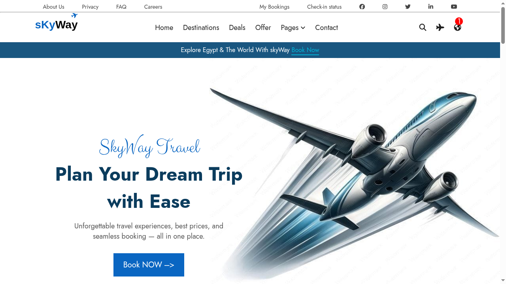
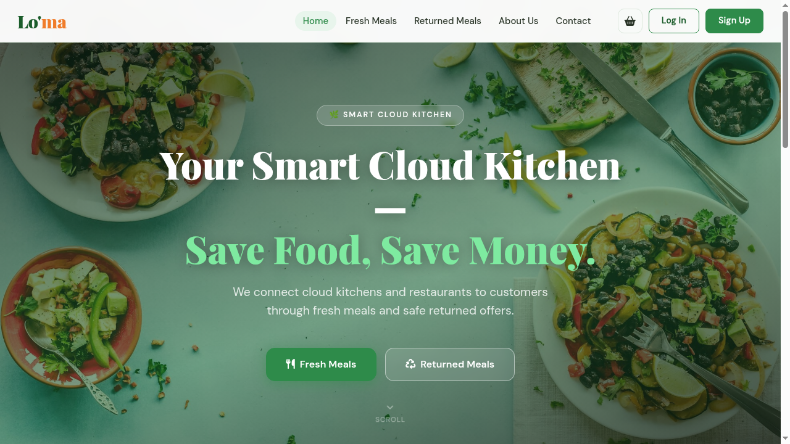

Information Systems Student · Faculty of Computers and Artificial Intelligence, Sadat City University

[LinkedIn](https://linkedin.com/in/ahmed-walied-allam-5a2b15384) ·
[GitHub](https://github.com/ahmedwaliedallam) ·
[Portfolio](https://ahmedwaliedallam.github.io/portfolio/) ·
[Email](mailto:ahmedwaliedallam4@gmail.com)

---

## About Me

I'm an Information Systems student at Sadat City University with a strong interest in building practical web applications.

I work on responsive front-end interfaces and WordPress websites, and I'm developing my full-stack skills with **C#, ASP.NET Core MVC, Entity Framework Core, and SQL Server**. I enjoy learning by building projects, solving problems, and improving the quality of my code.

## Skills & Technologies

Badges name technologies I use or have studied through project work, not proficiency ratings.

**Front-end**
- HTML5 · CSS3 · JavaScript
- Responsive Web Design
- Tailwind CSS

**Back-end & Databases**
- C#
- ASP.NET Core MVC
- Entity Framework Core · LINQ
- SQL Server

**CMS & E-commerce**
- WordPress
- WooCommerce

**Tools**
- Git · GitHub
- Visual Studio · Visual Studio Code

## Featured Projects

### SkyWay Travel

Travel website built with HTML and CSS, with destination and tour sections.

[Repository](https://github.com/ahmedwaliedallam/Project2-sKyWay-Travel-) · [Live Demo](https://ahmedwaliedallam.github.io/Project2-sKyWay-Travel-/)

### Lo'ma

Cloud-kitchen front-end featuring cart, login, registration and meal-management interfaces. This is a front-end demo, not a claim of production ordering or authentication services.

[Repository](https://github.com/ahmedwaliedallam/loma_1) · [Live Demo](https://ahmedwaliedallam.github.io/loma_1/)

### Portfolio

My personal portfolio presents more of my work and development journey.

[Visit Portfolio](https://ahmedwaliedallam.github.io/portfolio/)

## .NET Learning & Experience

- Completed learning modules covering C#, SQL, LINQ, Entity Framework Core, and ASP.NET Core MVC.
- Worked on an Information Management System using ASP.NET Core MVC and Entity Framework Core as part of ITI training.
- Currently strengthening my back-end development, database design, and full-stack application skills.

## Currently Focusing On

- Improving my ASP.NET Core MVC and SQL Server skills.
- Building complete web applications with front-end and back-end integration.
- Writing cleaner, more maintainable code and documenting projects clearly.

## GitHub Activity

Public snapshot checked on 23 November 2026: **6 public repositories** before creating this profile repository.

[View my repositories and contribution activity on GitHub](https://github.com/ahmedwaliedallam)

## Let's Connect

- **LinkedIn:** [linkedin.com/in/ahmed-walied-allam](https://linkedin.com/in/ahmed-walied-allam-5a2b15384)
- **Email:** [ahmedwaliedallam4@gmail.com](mailto:ahmedwaliedallam4@gmail.com)
- **Portfolio:** [ahmedwaliedallam.github.io/portfolio](https://ahmedwaliedallam.github.io/portfolio/)

---

*Always learning, building, and improving.*

